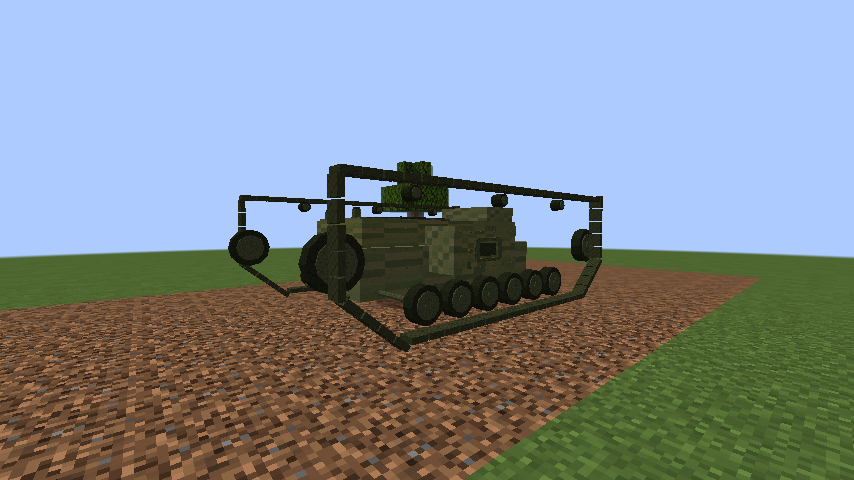
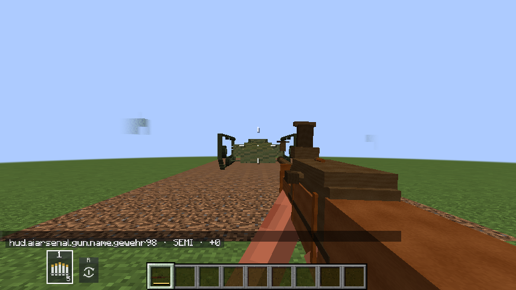

# AI Arsenal

Forge content mod for Minecraft 1.20.1. Adds vehicles, firearms, artillery, aircraft and equipment from several historical periods.

**Version:** `1.0.1-alpha.12` · **Minecraft:** `1.20.1` · **Forge:** `47.4.23` · **Java:** `17`

## In-game previews

Unedited F2 screenshots from a real 1.20.1 client in a disposable preview world. The simple test-world setting is intentional; these images show the in-game models and are not a claim of full gameplay verification.





## Content

- British Mark I tank, Gewehr 98 rifle and 57 mm ammunition.
- WWII and modern firearms, vehicles, aircraft, artillery and equipment.
- French and Russian Empire weapons and artillery inspired by 1812.
- In-game smoke and visual effects.

The item and entity IDs are part of existing worlds; avoid installing two versions of the mod at once. Back up worlds before updating.

## Install

1. Install Minecraft 1.20.1 and Forge 47.4.23 with Java 17.
2. Put the built `aiarsenal-*.jar` in the `mods` folder on the client and server.
3. Remove older AI Arsenal JARs from that folder.

Download the [AI Arsenal 1.0.1-alpha.12 JAR](https://github.com/standimaoff-oss/aimods/releases/download/v1.0.1-alpha.12/aiarsenal-1.0.1-alpha.12.jar) directly. The [pre-release page](https://github.com/standimaoff-oss/aimods/releases/tag/v1.0.1-alpha.12) also includes `SHA256SUMS` and build provenance.

## Build from source

```bash
cd mods/aiarsenal
./gradlew build --no-daemon
```

On Windows, run `gradlew.bat build --no-daemon` from `mods\aiarsenal`. The resulting JAR is in `mods/aiarsenal/build/libs/`.

## Controls

See [controls and operation](docs/controls.md).

## Third-party notices

See [`THIRD_PARTY_NOTICES.md`](THIRD_PARTY_NOTICES.md) for external asset and license acknowledgements.

---

### Кратко

Мод для Forge 1.20.1: техника, стрелковое оружие, артиллерия, авиация и снаряжение разных эпох. Mark I, Gewehr 98 и 57-мм боеприпасы входят в текущую ветку.
